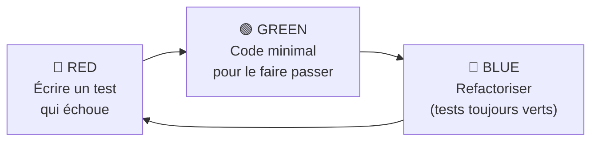
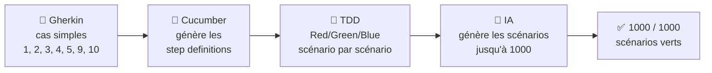

<div align="center">

# 🧪 TP4 — TDD, BDD & GenAI in Testing

**Module Test & Test Automation · ISEP 2026–2027**


*Trois katas de développement piloté par les tests : du test unitaire JUnit jusqu'aux spécifications exécutables Gherkin.*

</div>

---

## 👥 Équipe

- **Evan KESTANE**
- **Katchinninsongui SORO**
- **Said KONATE**

---

## 📑 Sommaire

1. [Aperçu](#-aperçu)
2. [Démarrage rapide](#-démarrage-rapide)
3. [Structure du projet](#-structure-du-projet)
4. [Méthodologie](#-méthodologie)
5. [Exercice 1 — PrimeChecker (TDD)](#-exercice-1--primechecker-tdd)
6. [Exercice 2 — FizzBuzz (TDD + IA)](#-exercice-2--fizzbuzz-tdd--ia)
7. [Exercice 3 — Roman Numerals (BDD + Cucumber)](#-exercice-3--roman-numerals-bdd--cucumber)
8. [Résultats](#-résultats)

---

## 🔭 Aperçu

| # | Exercice | Approche | Classe | Tests |
|:-:|:--|:--|:--|--:|
| 1 | Nombres premiers | TDD · Red/Green/Blue en binôme | `PrimeChecker` | **101** |
| 2 | FizzBuzz | TDD · tests générés avec l'IA | `FizzBuzz` | **106** |
| 3 | Chiffres romains | BDD · Gherkin + Cucumber + TDD | `RomanNumerals` | **1000** |

> 💡 **Principe directeur** — aucune ligne de code de production n'est écrite sans un test qui échoue au préalable. L'historique Git retrace chaque étape du cycle.

---

## 🚀 Démarrage rapide

### Prérequis

- **JDK 17+** (développé avec Temurin 25)
- **Maven 3.8+**

### Lancer les tests

```bash
# Toute la suite (JUnit + Cucumber)
mvn test

# Un exercice en particulier
mvn test -Dtest=PrimeCheckerTest
mvn test -Dtest=FizzBuzzTest
mvn test -Dtest=CucumberTestRunner
```

📊 Après exécution, le rapport Cucumber est disponible dans **`target/cucumber-report.html`**.

---

## 🗂 Structure du projet

```
tp4/
├── pom.xml                                         # JUnit 5, Cucumber, Surefire
└── src/
    ├── main/java/com/example/
    │   ├── PrimeChecker.java                       # Exercice 1
    │   ├── FizzBuzz.java                           # Exercice 2
    │   └── RomanNumerals.java                      # Exercice 3
    └── test/
        ├── java/com/example/
        │   ├── PrimeCheckerTest.java               # Tests unitaires paramétrés
        │   ├── FizzBuzzTest.java                   # Tests unitaires paramétrés
        │   └── cucumber/
        │       ├── CucumberTestRunner.java         # Suite JUnit Platform → moteur Cucumber
        │       └── RomanNumeralsSteps.java         # Glue Given / When / Then
        └── resources/features/
            └── roman_numerals.feature              # Spécifications Gherkin
```

---

## 🔁 Méthodologie

### Le cycle Red · Green · Blue



| Étape | Règle |
|:--|:--|
| 🔴 **RED** | Un seul nouveau test, qui **doit échouer**. S'il passe immédiatement, il n'apporte rien : on en écrit un autre. |
| 🟢 **GREEN** | Le code **le plus simple possible** qui fait passer le test — sans anticiper la suite. |
| 🔵 **BLUE** | On améliore le code et les tests (duplication, lisibilité, paramétrage) sans changer le comportement. |

### Convention de commits

Chaque étape fait l'objet d'un commit dédié, ce qui rend le cycle lisible directement dans l'historique :

| Préfixe | Signification |
|:--|:--|
| `RED:` | Ajout d'un test en échec |
| `GREEN:` | Implémentation qui fait passer le test |
| `BLUE:` | Refactoring sans changement de comportement |
| `TEST:` | Test ajouté déjà vert (couverture, non-régression) |
| `BDD:` | Écriture de scénarios Gherkin |
| `BUILD:` | Configuration Maven / outillage |

---

## 🔢 Exercice 1 — PrimeChecker (TDD)

### Énoncé

Écrire une classe `PrimeChecker` qui détermine si un entier (à partir de 0, sans validation) est premier, en suivant strictement le cycle Red/Green/Blue. **Le RED est écrit par un étudiant, le GREEN et le BLUE par le suivant**, avec un commit/push à chaque étape.

### Progression

Un nouveau RED n'est écrit que lorsqu'un cas **casse** l'implémentation courante :

| Test ajouté | Pourquoi il échoue | Évolution du code |
|:--|:--|:--|
| `0` → `false` | méthode non implémentée | `return false;` |
| `1` → `false` | *déjà vert* | — |
| `2` → `true` | tout renvoie `false` | `if (number == 2) return true;` |
| `3` → `true` | seul 2 est premier | `number < 2` → `false`, sinon `true` |
| `4` → `false` | tout nombre ≥ 2 est premier | rejet des nombres pairs > 2 |
| `9` → `false` | impair mais divisible par 3 | **boucle sur les diviseurs** |
| `0 … 100` | *déjà vert* | validation complète |

### Implémentation finale

```java
public boolean isPrime(int number) {
    if (number < 2) {
        return false;
    }
    for (int divisor = 2; divisor * divisor <= number; divisor++) {
        if (number % divisor == 0) {
            return false;
        }
    }
    return true;
}
```

> ⚡ **Optimisation (BLUE)** — il suffit de chercher un diviseur jusqu'à **√n** : si `n = a × b` avec `a ≤ b`, alors `a ≤ √n`.

**Couverture :** 0 et 1 · les 25 nombres premiers ≤ 100 · les 74 nombres composés ≤ 100 → **101 tests**.

---

## 🥤 Exercice 2 — FizzBuzz (TDD + IA)

### Règles

| Condition | Résultat |
|:--|:--|
| multiple de 3 **et** de 5 | `"FizzBuzz"` |
| multiple de 3 | `"Fizz"` |
| multiple de 5 | `"Buzz"` |
| sinon | le nombre lui-même |

### Progression

`1 → "1"` · `2 → "2"` · `3 → "Fizz"` · `5 → "Buzz"` · 🔵 *passage en `@CsvSource`* · `15 → "FizzBuzz"` · `30 → "FizzBuzz"` · **1 → 100 générés avec l'IA puis relus**

### Implémentation finale

```java
public String convert(int number) {
    if (number % 15 == 0) return "FizzBuzz";
    if (number % 3 == 0)  return "Fizz";
    if (number % 5 == 0)  return "Buzz";
    return String.valueOf(number);
}
```

> ⚠️ **Piège classique** — le test `% 15` doit précéder `% 3` et `% 5`, sinon 15 renverrait `"Fizz"`. C'est précisément le test RED `15 → FizzBuzz` qui l'a révélé.

### Rôle de l'IA

Les jeux de données jusqu'à 100 (Fizz / Buzz / FizzBuzz / nombres simples) ont été **générés avec un assistant IA**, puis **vérifiés manuellement** sur les cas sensibles (45, 60, 75, 90 → FizzBuzz ; 99 → Fizz ; 100 → Buzz). L'IA accélère la rédaction ; la responsabilité des tests reste humaine.

**Couverture :** 6 exemples de l'énoncé + 100 valeurs → **106 tests**.

---

## 🏛 Exercice 3 — Roman Numerals (BDD + Cucumber)

### Démarche



### Spécification Gherkin

```gherkin
Feature: Roman Numerals Converter
  As a developer
  I want to convert integers to Roman numerals
  So that numbers can be displayed in the Roman numeral system

  Scenario: Convert 4 to Roman numerals
    Given I have a Roman numeral converter
    When I convert 4 to Roman numerals
    Then the result should be "IV"

  Scenario Outline: Convert <number> to Roman numerals
    Given I have a Roman numeral converter
    When I convert <number> to Roman numerals
    Then the result should be "<roman>"

    Examples:
      | number | roman        |
      |     40 | XL           |
      |    444 | CDXLIV       |
      |   1000 | M            |
```

### Glue Cucumber

Les squelettes de steps ont été **générés par Cucumber** lors d'une première exécution sans implémentation, puis complétés :

```java
@When("I convert {int} to Roman numerals")
public void i_convert_to_roman_numerals(Integer number) {
    result = romanNumerals.toRoman(number);
}

@Then("the result should be {string}")
public void the_result_should_be(String expected) {
    assertEquals(expected, result);
}
```

### TDD piloté par les scénarios

Tous les scénarios ont été écrits **avant** le code (approche BDD), marqués du tag `@wip` et exclus du runner. Chaque 🔴 RED consistait à **retirer le tag** d'un scénario pour l'activer.

| Étape | Résultat |
|:--|:--|
| Scénarios 1 → 10 | `if` successifs (`"I".repeat(n)`, `IV`, `V`, `IX`, `X`) |
| 🔵 BLUE | remplacement des `if` par une **table valeurs / symboles** |
| 🔴 993 scénarios générés | 32 passent déjà, **961 échouent** dès 40 (`L`, `C`, `D`, `M` inconnus) |
| 🟢 GREEN | ajout des symboles manquants — **aucune modification de l'algorithme** |

### Implémentation finale — algorithme glouton

```java
private static final int[]    VALUES  = {1000, 900, 500, 400, 100, 90, 50, 40, 10, 9, 5, 4, 1};
private static final String[] SYMBOLS = {"M", "CM", "D", "CD", "C", "XC", "L", "XL", "X", "IX", "V", "IV", "I"};

public String toRoman(int number) {
    StringBuilder roman = new StringBuilder();
    int remaining = number;
    for (int i = 0; i < VALUES.length; i++) {
        while (remaining >= VALUES[i]) {
            roman.append(SYMBOLS[i]);
            remaining -= VALUES[i];
        }
    }
    return roman.toString();
}
```

> 🧠 **Exemple** — `444` : `CD` (400) → reste 44 → `XL` (40) → reste 4 → `IV` → **`CDXLIV`**

**Couverture :** 7 scénarios explicites + 993 exemples générés → **1000 scénarios**.

---

## ✅ Résultats

```
[INFO] Tests run: 101,  Failures: 0, Errors: 0  -- PrimeCheckerTest
[INFO] Tests run: 106,  Failures: 0, Errors: 0  -- FizzBuzzTest
[INFO] Tests run: 1000, Failures: 0, Errors: 0  -- CucumberTestRunner
[INFO] Tests run: 1207, Failures: 0, Errors: 0, Skipped: 0
[INFO] BUILD SUCCESS
```

### Enseignements

- **TDD** — le code émerge des tests : partir du cas le plus simple et ne généraliser que lorsqu'un test l'exige produit un code minimal et entièrement couvert.
- **BDD** — Gherkin rend les exigences lisibles par tous et les transforme en **spécifications exécutables** qui servent aussi de documentation vivante.
- **Refactoring** — un bon BLUE rend le code générique : pour les chiffres romains, 993 nouveaux scénarios ont été satisfaits en ajoutant de simples données.
- **IA générative** — un accélérateur efficace pour produire des jeux de tests volumineux, à condition de **relire et valider** ce qu'elle génère.

---

<div align="center">

**Evan KESTANE · Katchinninsongui SORO · Said KONATE**

ISEP — Module *Test & Test Automation* — TP4 · Novembre 2026

</div>
